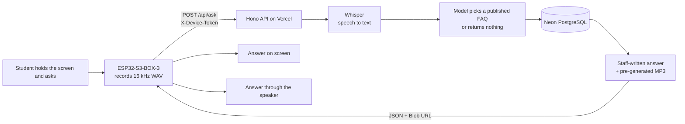

# AskNEU

> A university information kiosk. A student asks a question out loud, and AskNEU answers
> with a staff-written FAQ answer — on screen and read aloud.

The rule that shapes the whole system:

**Staff write the answers. AskNEU only finds and reads them.**

A model picks an FAQ ID from a closed list. It never writes the answer text, and the server
rejects any ID that is not in the published list.

## The kiosk loop



Three outcomes come back from `/api/ask`: `answer` (high confidence), `hedged` (lower
confidence, answered anyway) and `route` (nothing fits — the student is sent to an office).
A technical failure shows BUSY on the kiosk instead of guessing.

## Stack

| Layer | Choice |
| --- | --- |
| Kiosk | ESP32-S3-BOX-3, ESP-IDF v5.4, LVGL 9, `esp_codec_dev`, Helix MP3 |
| API | Hono (TypeScript) on Vercel serverless |
| Database | Neon PostgreSQL + Drizzle ORM |
| Auth | Better Auth, email + password, public sign-up disabled |
| Speech to text | Cloudflare Workers AI — `@cf/openai/whisper-large-v3-turbo` |
| Answer picker | Cloudflare Workers AI — `@cf/openai/gpt-oss-20b` |
| Speech output | Cloudflare Workers AI — `@cf/deepgram/aura-2-en`, generated at publish time |
| Audio storage | Vercel Blob |
| Staff console | React + Vite |

## Repository layout

```text
askNEU/
├── api/           Vercel serverless entrypoint (one Hono function)
├── server/        Hono app, auth, routes, database access, Cloudflare helpers
├── packages/core/ FAQ picker prompt, parsing and validation + tests
├── src/           React staff console (FAQ and office management)
├── drizzle/       PostgreSQL migrations
├── scripts/       local dev server and staff seed script
└── firmware/      ESP32-S3-BOX-3 kiosk firmware (separate ESP-IDF project)
```

`firmware/` has its own [README](./firmware/README.md) with the hardware, flashing and
Wi-Fi setup details.

## Local development

Requirements: Node.js 20+, npm, and a PostgreSQL database (Neon or local).

```powershell
npm install
Copy-Item .env.example .env    # then fill in the values
npx drizzle-kit migrate        # apply migrations
npm run dev                    # API on http://localhost:3000
npm run dev:frontend           # staff console (Vite)
```

Create the first staff account:

```powershell
$env:STAFF_NAME = "Your Name"
$env:STAFF_EMAIL = "you@example.com"
$env:STAFF_PASSWORD = "at-least-8-chars"
npm run seed:staff
```

### Environment variables

All of these belong in `.env` locally and in the Vercel project settings in production.
Values are never committed.

| Name | Purpose |
| --- | --- |
| `DATABASE_URL` | PostgreSQL connection string |
| `BETTER_AUTH_SECRET` | Session signing secret |
| `BETTER_AUTH_URL` | Public origin of the app, e.g. `https://ask-neu.vercel.app` |
| `CF_ACCOUNT_ID`, `CF_API_TOKEN` | Cloudflare Workers AI access |
| `BLOB_READ_WRITE_TOKEN` | Vercel Blob store used for FAQ audio |
| `DEVICE_TOKEN` | Shared secret the kiosk sends as `X-Device-Token` |
| `DISABLE_SIGNUP` | `true` in production: staff sign in, they do not register |

Adding staff is a controlled action, not a public form:

```powershell
$env:STAFF_NAME = "New Staff"
$env:STAFF_EMAIL = "staff@example.com"
$env:STAFF_PASSWORD = "at-least-8-chars"
npm run seed:staff
```

## API

Kiosk routes require `X-Device-Token`. Admin routes require a staff session cookie.

| Method | Route | Purpose |
| --- | --- | --- |
| `POST` | `/api/ask` | Kiosk question: WAV body → answer JSON + audio URL |
| `GET` | `/api/faq` | Published FAQ list for the kiosk browse screen |
| `GET` | `/api/health` | API health |
| `GET` | `/api/health/db` | Database connectivity |
| `POST` | `/api/auth/sign-in/email` | Staff sign in |
| `GET`, `POST` | `/api/admin/faqs` | List or create FAQs |
| `PATCH`, `DELETE` | `/api/admin/faqs/:id` | Edit or delete an FAQ |
| `POST` | `/api/admin/faqs/:id/publish` | Generate MP3, upload to Blob, publish |
| `POST` | `/api/admin/faqs/:id/audio` | Regenerate one FAQ's audio |
| `GET`, `POST` | `/api/admin/offices` | List or create offices |
| `PATCH`, `DELETE` | `/api/admin/offices/:id` | Edit or delete an office |

`POST /api/ask` response shape:

```json
{
  "outcome": "answer",
  "text": "Enrollment runs June 1 to 15 at the Registrar, room 204.",
  "office": { "name": "Registrar", "room": "204", "hours": "8:00-17:00" },
  "audio_urls": ["https://.../faq/1/clip.mp3"],
  "faq_id": 1,
  "updated_at": "2026-11-08",
  "latency_ms": { "stt": 1100, "model": 900, "total": 2200 }
}
```

## Deploy

1. Push `master`. Vercel builds the staff console (`npm run build` → `dist`) and the
   `api/index.ts` function.
2. Add the environment variables above to the Vercel project (Production).
3. Apply migrations against the production database: `npx drizzle-kit migrate`.
4. Check `https://<domain>/api/health` and `/api/health/db`.
5. Point the kiosk at the deployment: `ASKNEU_API_BASE_URL=https://<domain>` and the same
   `DEVICE_TOKEN`, then rebuild and flash the firmware.

## Security notes

- `.env`, `firmware/sdkconfig` and the internal docs folder are gitignored. Only
  `.env.example` (names, no values) is committed.
- Public sign-up is disabled in production; accounts are created with `npm run seed:staff`.
- The kiosk token is a shared secret baked into the firmware. Rotating it means reflashing
  the device. Treat the firmware binary as public.
- The kiosk only has 16 kHz mono capture and 8 s per question; the API should enforce the
  same limits on incoming audio.

## Contributing

`master` is production, `dev` is integration. Branch from `dev`, open a PR into `dev`.

```powershell
git checkout dev
git pull origin dev
git checkout -b feat/your-short-name

npm run typecheck
npm run build
npm run test:core
```

Do not commit `.env`, `firmware/sdkconfig`, generated credentials or production secrets.
