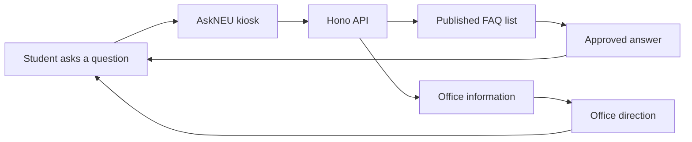

# AskNEU

> A friendly university information kiosk that helps students find the right answer or office.

## What is AskNEU?

AskNEU is a project for Northeastern University students. A student will be able to ask a
question by voice, and AskNEU will guide them to an approved FAQ answer or the correct office.

The important rule is simple:

**Staff write the answers. AskNEU only finds and reads them.**

This keeps information accurate, consistent, and easy for staff to update.

## How it works



## Project layout

```text
askNEU/
├── src/       React staff dashboard
├── server/    Hono API, authentication, and database code
├── api/       Vercel serverless entrypoint
├── drizzle/   PostgreSQL database migrations
├── scripts/   Local development and staff setup scripts
└── Documents/ Project guides and team requirements
```

The frontend and backend live in one repository and deploy together to Vercel.

## Current features

- Staff authentication with Better Auth
- FAQ management: list, create, edit, publish/unpublish, and delete
- Office management: list, create, edit, and delete
- PostgreSQL database with Drizzle ORM
- React + Vite frontend scaffold
- Health checks for the API and database

The voice question flow and kiosk experience are planned next.

## Run locally

### Requirements

- Node.js
- npm
- A configured PostgreSQL database

### Start the backend

```powershell
npm install
npm run dev
```

The API runs at `http://localhost:3000`.

### Start the frontend

In another terminal:

```powershell
npm run dev:frontend
```

The frontend runs at the Vite development URL shown in the terminal.

### Create the first staff account

Set `STAFF_NAME`, `STAFF_EMAIL`, and `STAFF_PASSWORD` in your local environment, then run:

```powershell
npm run seed:staff
```

Never commit `.env` or other secrets. Use [.env.example](./.env.example) as a template.

## Main API routes

All admin routes require a signed-in staff session.

| Method | Route | Purpose |
| --- | --- | --- |
| `GET` | `/api/health` | Check that the API is running |
| `GET` | `/api/health/db` | Check database connectivity |
| `POST` | `/api/auth/sign-in/email` | Sign in |
| `GET`, `POST` | `/api/admin/faqs` | List or create FAQs |
| `PATCH`, `DELETE` | `/api/admin/faqs/:id` | Edit or delete an FAQ |
| `GET`, `POST` | `/api/admin/offices` | List or create offices |
| `PATCH`, `DELETE` | `/api/admin/offices/:id` | Edit or delete an office |

## Contributing safely

The shared integration branch is `dev`. Do not push directly to `main` or `dev`.

```powershell
git clone https://github.com/EmeterioF/askNEU.git
cd askNEU
npm install
git checkout dev
git pull origin dev
git checkout -b feat/your-short-name
```

After making changes:

```powershell
npm run typecheck
npm run build
git add .
git commit -m "Describe your change"
git push -u origin feat/your-short-name
```

Open a pull request from your branch into `dev`.

## Project goal

AskNEU should make campus information easier to find while keeping staff in control of the
content students receive.
